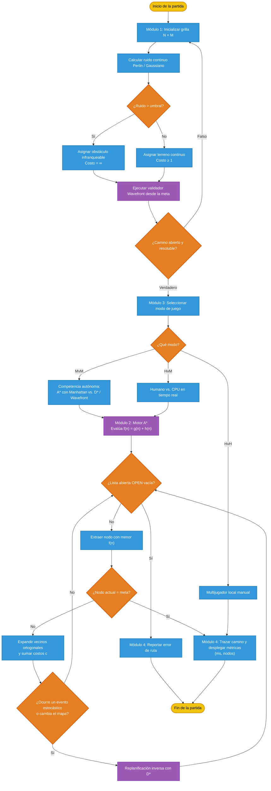

# stochastic-maze-navigation
An autonomous maze-solving system featuring probabilistic occupancy grids, stochastic terrain generation, and real-time pathfinding using optimized A* and D* algorithms, adding probabilistic noise

## Generación espacial y reducción del costo computacional

La clase `Map` implementa la representación y generación del entorno de navegación mediante una grilla de ocupación estocástica. En lugar de decidir el estado de cada celda utilizando una secuencia de números aleatorios que deba conservarse explícitamente, se utiliza una función de *space hashing* basada en las coordenadas espaciales y en una semilla fija. Cada posición `(x, y)` se asocia primero con un bloque espacial de tamaño `4 × 4` mediante `x // 4` y `y // 4`; posteriormente, las coordenadas del bloque se combinan con constantes enteras y la semilla para construir una clave determinista. Sobre esa clave se calcula un valor hash mediante `zlib.crc32`, y el resultado se normaliza al intervalo `[0, 100)`. Si el valor obtenido es menor que `density_rate × 100`, la celda se clasifica como obstáculo con costo `∞`; en caso contrario, se le asigna un costo transitable igual a `1.0`.

Este procedimiento permite generar valores aparentemente aleatorios, pero reproducibles y consistentes para una misma posición y semilla. La ventaja principal es que el estado de una celda puede obtenerse directamente a partir de sus coordenadas, sin recorrer una estructura adicional de números aleatorios ni almacenar una distribución completa para consultar posteriormente cada ubicación. La operación de consulta tiene costo constante, `O(1)`, y la memoria auxiliar utilizada por el mecanismo de hashing es constante, `O(1)`. Por tanto, aunque la materialización completa de la matriz sigue requiriendo `O(NM)` operaciones cuando se llena toda la grilla, el cálculo de cada celda es independiente, directo y fácilmente paralelizable. Además, el mismo modelo puede utilizarse de forma perezosa durante la exploración: una celda se evalúa únicamente cuando el algoritmo de navegación la necesita. Esto evita trabajo innecesario en regiones que no son visitadas por A* o D* y resulta especialmente útil en mapas grandes o dinámicos.

La función `get_cell_cost` añade una excepción importante al modelo probabilístico: las posiciones pertenecientes a `carved_corridors` siempre reciben costo `1.0`, incluso si el hash las habría clasificado como obstáculos. De esta manera, los corredores construidos durante la generación del mapa tienen prioridad sobre la distribución estocástica y pueden utilizarse para garantizar conectividad. La clase `Map` inicializa la grilla, genera el terreno mediante `space_hashing`, selecciona puntos aleatorios de forma reproducible a partir de `seed` y utiliza una estructura tipo conjunto disjunto dentro del procedimiento de Kruskal para conectar dichos puntos con corredores ortogonales. Las aristas entre puntos se ponderan mediante distancia Manhattan, se procesan en orden creciente y se aceptan únicamente cuando conectan componentes diferentes. Este proceso genera una red de corredores con menor riesgo de componentes aislados; finalmente, las posiciones de inicio y meta se fuerzan como transitables.

Desde el punto de vista científico, el diseño separa dos procesos que cumplen funciones distintas: el *space hashing* controla la distribución espacial de obstáculos de manera determinista, mientras que Kruskal introduce una restricción topológica para asegurar rutas practicables. La semilla actúa como parámetro de control experimental: al mantenerla constante, se puede reproducir exactamente el mismo mapa y comparar tiempos de ejecución, número de nodos expandidos, longitud de ruta y costo acumulado entre diferentes estrategias de búsqueda. Al modificar la semilla o `density_rate`, se obtienen nuevas realizaciones del entorno sin cambiar la lógica del generador. Esta combinación de aleatoriedad reproducible, consulta espacial de costo constante y corrección estructural mediante corredores proporciona una base eficiente para evaluar navegación probabilística y replanificación en mapas estocásticos.

