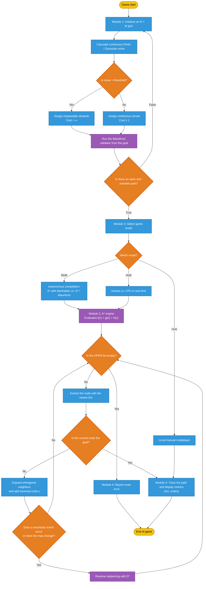

# stochastic-maze-navigation
An autonomous maze-solving system featuring probabilistic occupancy grids, stochastic terrain generation, and real-time pathfinding using optimized A* and D* algorithms with probabilistic noise.

## Spatial Generation and Computational Cost Reduction

The `Map` class implements the representation and generation of the navigation environment through a stochastic occupancy grid. Instead of determining the state of each cell using a sequential random process, the system uses spatial hashing to calculate each cell's value independently based on its position and a seed.

This procedure generates values that appear random while remaining reproducible and consistent for the same position and seed. The primary advantage is that a cell's state can be obtained on demand without storing the entire map or iterating through all previous cells, reducing memory usage and computational overhead.

The `get_cell_cost` function adds an important exception to the probabilistic model: positions belonging to `carved_corridors` always receive a cost of `1.0`, even if the hash would otherwise classify them as obstacles or high-cost terrain. This guarantees that the generated maze contains traversable routes for the navigation algorithms.

From a scientific perspective, the design separates two processes with different purposes: *spatial hashing* deterministically controls the distribution of obstacles, while the path-carving process guarantees connectivity and solvability. This combination provides both stochastic variability and reproducible experiments.

    

To generate the pseudorandom maze dynamically, the `generate_map` method uses Python's `time` library to create a seed from `time.thread_time_ns()`. This value is assigned to `self.seed`, allowing each maze generation to use a different time-based seed while preserving deterministic spatial hashing and corridor generation for that specific maze.
